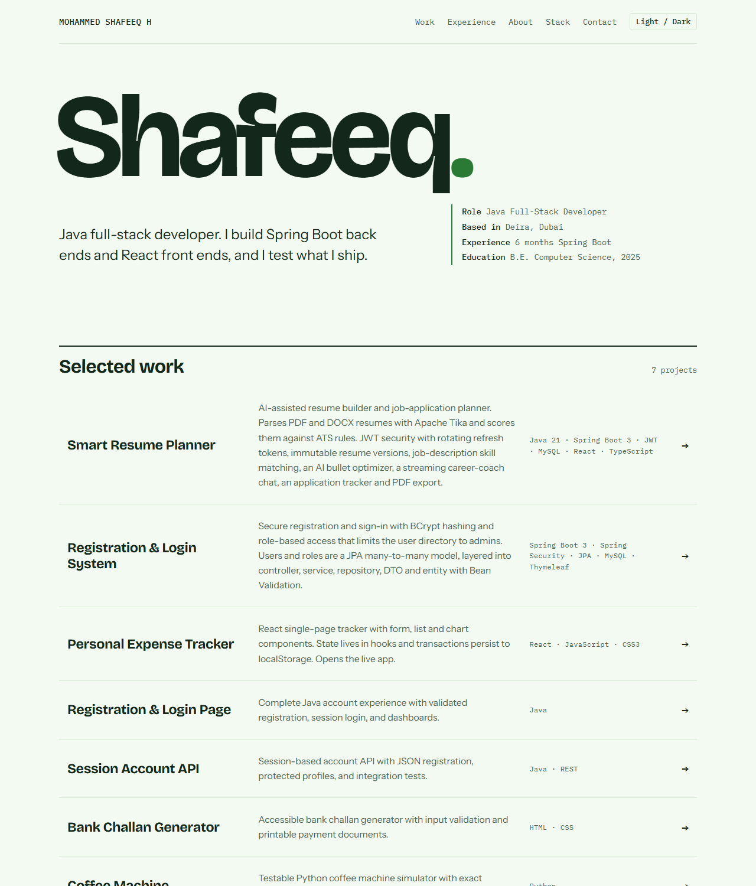

# Mohammed Shafeeq H — Portfolio

Personal portfolio of Mohammed Shafeeq H, a Java full-stack developer based in Coimbatore, India. It covers selected projects, internship experience, education, certifications and technical skills.

**Live site:** https://shafeeq0807.github.io/



## Highlights

- Single static page: no framework, no build step, no dependencies beyond Google Fonts.
- Bright light theme by default, with a sliding switch in the nav bar for the aqua dark theme (the choice is remembered).
- Responsive from phone to desktop, keyboard-friendly focus states, and reduced-motion support.

## Sections

- **Selected work:** Smart Resume Planner, Registration & Login System, Personal Expense Tracker and more, each linked to its code or live app.
- **Experience:** Java Software Development Intern at MAYVEL Technologies; Full-Stack Developer Intern at Xylonics.
- **About:** B.E. Computer Science and Engineering, KPR Institute of Engineering and Technology (2021 – 2025), and certifications.
- **Stack:** Java, Spring Boot, Spring Security, React, TypeScript, MySQL, MongoDB, Git, AWS and more.

## Run locally

```bash
python -m http.server 8000
```

Open http://localhost:8000.

## Edit the content

Everything lives in `index.html`: styles in the `<style>` block, content in the markup. Run `python check_links.py` to verify local links and anchors; GitHub Actions runs the same check on every push.

## Contact

shafeeqstanes@gmail.com · [LinkedIn](https://www.linkedin.com/in/mohammad-shafeeq-63559a227/) · [GitHub](https://github.com/Shafeeq0807)
